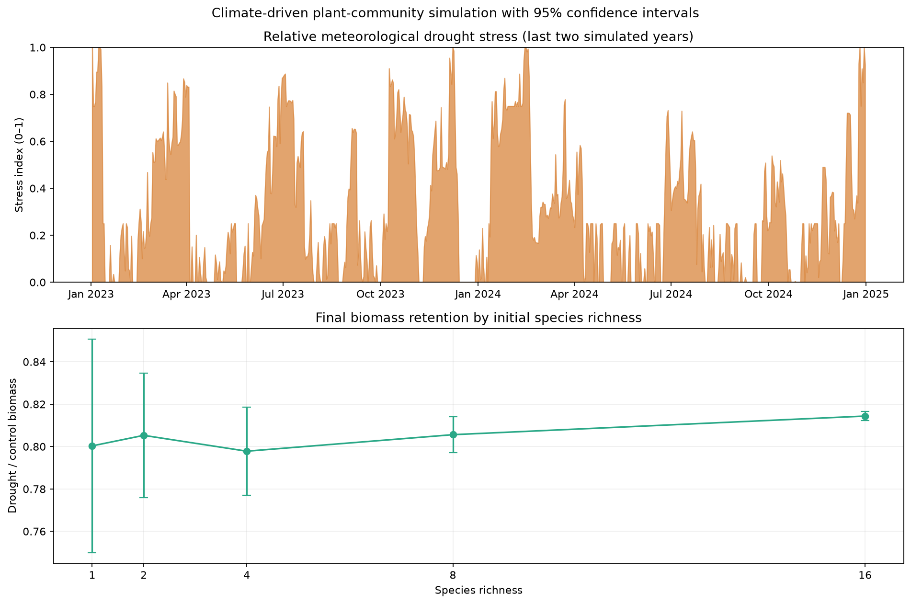
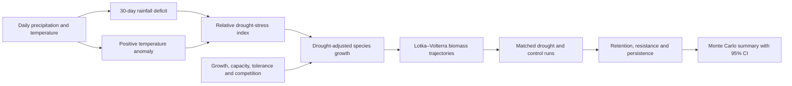

<div align="center">

# Drought & Plant Species Modelling

**Climate-driven plant-community simulation with explicit uncertainty**

A 2026 reimplementation inspired by the 2023 MCM/ICM Problem A project

[](#verified-beijing-demo)
[](#model)
[](#verified-beijing-demo)
[](#quickstart)

[Quickstart](#quickstart) · [Model](#model) · [Verified Demo](#verified-beijing-demo) · [Evidence Boundaries](#evidence-boundaries)

</div>

---

## Overview

This project investigates how meteorological drought stress affects simulated plant communities with different initial species richness. It combines:

- historical daily weather from [Open-Meteo](https://open-meteo.com/);
- a transparent, reproducible relative drought-stress index;
- drought-adjusted Lotka–Volterra population dynamics;
- matched drought/no-drought control simulations;
- Monte Carlo replication and 95% confidence intervals.

The ecological parameters are synthetic. The project is an **exploratory simulator**, not a field-calibrated ecological forecast. The original 2023 report is preserved only as a [historical reference](references/2023-report.pdf).



## Quickstart

Requires Python 3.11 or newer. Verified with Python 3.12.

```bash
python3.12 -m venv .venv
source .venv/bin/activate
pip install -e .
```

Run the default Beijing demo with real historical weather:

```bash
drought-simulate --output outputs --replicates 12
```

Choose another location or period:

```bash
drought-simulate \
  --latitude 31.2304 \
  --longitude 121.4737 \
  --start 2020-01-01 \
  --end 2024-12-31 \
  --replicates 20 \
  --output outputs-shanghai
```

Run without network access using deterministic synthetic weather:

```bash
drought-simulate --offline --replicates 12 --output outputs-offline
```

## Model



### Relative meteorological stress

The index is defined directly in the code:

```text
stress = 0.75 × rainfall deficit + 0.25 × positive temperature anomaly
```

Rainfall deficit compares 30-day precipitation with the day-of-year climatological mean. Temperature anomaly uses the corresponding daily mean and standard deviation. Components and the final index are clipped to `[0, 1]`.

This is a **custom relative stress index**, not SPI, SPEI, or an official drought classification.

### Community dynamics

For species `i`, biomass follows a generalized Lotka–Volterra system:

```text
dx_i/dt = x_i × [r_i × stress_response_i(d_t) - Σ_j competition_ij × x_j]
stress_response_i = 1 - (1 - drought_tolerance_i) × 0.9 × d_t
```

Each community is simulated under both the observed stress series and a matched zero-stress control. The same species composition, initial biomass, and competition matrix are used in both runs.

### Metrics

- **Biomass retention:** final drought biomass divided by final control biomass.
- **Minimum biomass ratio:** minimum drought/control biomass ratio after a 30-day burn-in.
- **Final persistence:** fraction of species above the defined biomass threshold at the end.
- **Uncertainty:** mean, standard deviation, and 95% normal-approximation confidence interval across independently seeded community compositions.

## Verified Beijing Demo

The committed figure and values below were generated by an actual run using:

- Source: **Open-Meteo Historical Weather API**
- Coordinates: **39.9042, 116.4074** — Beijing
- Simulation period: **30 January 2020 – 31 December 2024**
- Climate days after the rolling-window warm-up: **1,798**
- Richness levels: **1, 2, 4, 8, 16**
- Replicates per level: **12**
- Total drought simulations plus matched controls: **60 + 60**

| Initial richness | Mean final biomass retention | 95% CI half-width | Mean minimum biomass ratio | Mean final persistence |
| ---: | ---: | ---: | ---: | ---: |
| 1 | 0.8003 | ±0.0504 | 0.7082 | 1.0000 |
| 2 | 0.8053 | ±0.0293 | 0.7142 | 1.0000 |
| 4 | 0.7978 | ±0.0207 | 0.7031 | 1.0000 |
| 8 | 0.8056 | ±0.0085 | 0.7168 | 0.9896 |
| 16 | 0.8144 | ±0.0022 | 0.7308 | 0.8906 |

### What the Demo Actually Shows

- Higher richness was associated with **lower between-replicate variance** in this parameterisation.
- Mean biomass retention did **not** increase monotonically across richness levels.
- The 16-species group had the highest mean retention but **lower final persistence**, showing that aggregate biomass and species survival measure different outcomes.
- Confidence intervals overlap across low-richness groups; the demo does not claim a statistically proven universal diversity effect.

The offline mode was also run successfully to verify that the complete pipeline works without network access.

## Outputs

```text
outputs/
├── climate_stress.csv        # Weather and computed daily stress
├── simulation_results.csv    # One row per simulated community
├── richness_summary.csv      # Means, spread and confidence intervals
├── metadata.json            # Source, period, parameters and interpretation
└── simulation_report.png    # Generated figure
```

## Project Structure

```text
src/drought_sim/
├── climate.py      # Open-Meteo client, offline climate and stress index
├── community.py    # ODE dynamics, matched controls and Monte Carlo runs
├── reporting.py    # Climate and uncertainty visualisation
└── pipeline.py     # End-to-end CLI
assets/             # Figure from the verified Beijing run
references/         # Original 2023 report for provenance only
```

## Evidence Boundaries

- Weather inputs are real; species parameters and interaction matrices are synthetic.
- The model is not fitted to observed biomass or species-survival measurements.
- Results are conditional on the chosen growth, capacity, tolerance, and competition assumptions.
- The simulator does not provide conservation thresholds, optimal species counts, or land-management recommendations.
- Future work should use observed community data, spatially explicit climate, calibrated parameters, and formal global sensitivity analysis.

## Author and Historical Work

**Junjia Cao** designed and implemented this 2026 version. In the original Team 2302264 project, Junjia Cao was responsible for all code and mathematical modelling work. The team authorised preservation of the original report in this repository.

## Licence and Attribution

The new source code and original documentation are available under the [MIT License](LICENSE). Weather data are obtained from [Open-Meteo](https://open-meteo.com/) and remain subject to the provider's terms. The historical team-authored PDF is not relicensed under MIT; see [`NOTICE.md`](NOTICE.md). Citation metadata is provided in [`CITATION.cff`](CITATION.cff).
